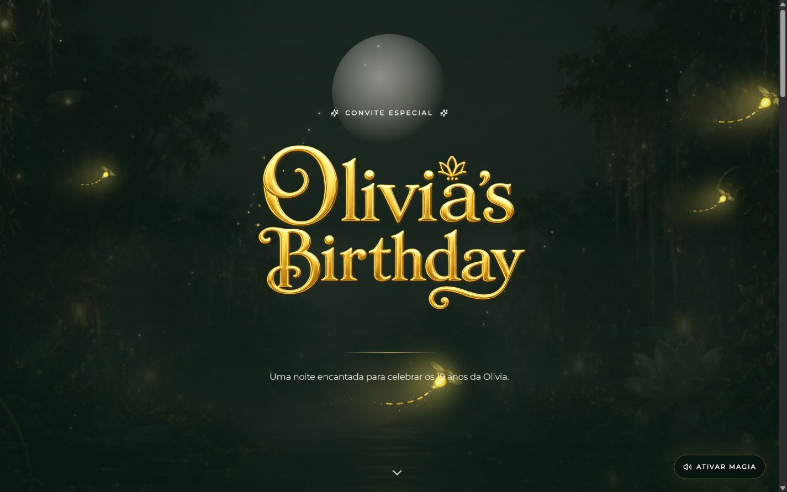
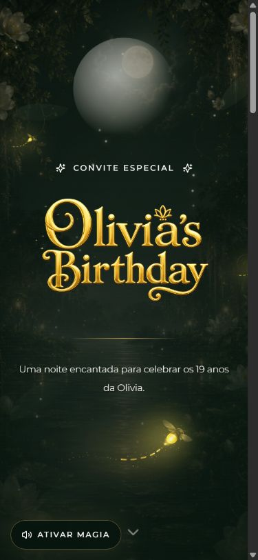

# Convite Olivia

Convite web com direção visual, animações e confirmação de presença.

**Next.js · TypeScript · Tailwind CSS · Framer Motion**

**Estado:** interface implementada. O envio de RSVP depende da configuração de um endpoint próprio.



Capturas reais da página inicial em execução local, sem nomes ou respostas de convidados. O formulário não foi enviado durante as capturas.

<details>
<summary>Ver no celular</summary>

Captura da interface no celular.



</details>

## O que demonstra

- Composição visual adaptada para desktop e celular.
- Animações e efeitos de entrada.
- Áudio ativado por interação do visitante.
- Formulário com integração configurável para confirmação de presença.

## Executar localmente

```bash
npm install
npm run dev
```

Abra `http://localhost:3000`. Para o build, execute `npm run build`.

## RSVP com Google Sheets

Use uma planilha própria para receber as confirmações. O link de uma planilha de convidados não faz parte desta apresentação.

Para ligar o formulario do site na planilha:

1. Abra [script.google.com](https://script.google.com/) e crie um novo projeto.
2. Cole o conteudo de `google-apps-script/rsvp-web-app.gs`.
3. Clique em **Deploy > New deployment > Web app**.
4. Configure **Execute as: Me** e **Who has access: Anyone**.
5. Copie a URL final terminada em `/exec`.
6. No Netlify, adicione as variaveis:

```bash
NEXT_PUBLIC_RSVP_ENDPOINT=https://script.google.com/macros/s/SEU_ID/exec
NEXT_PUBLIC_RSVP_REQUEST_MODE=no-cors
```

Depois de salvar as variaveis, rode um novo deploy no Netlify.

O payload enviado é:

```json
{
  "name": "Nome do convidado",
  "event": "Olivia's Birthday",
  "confirmedAt": "2026-06-30T00:00:00.000Z",
  "source": "site",
  "userAgent": "Mozilla/5.0..."
}
```

Para adicionar música, coloque o arquivo em `public/audio/magia.mp3`.
